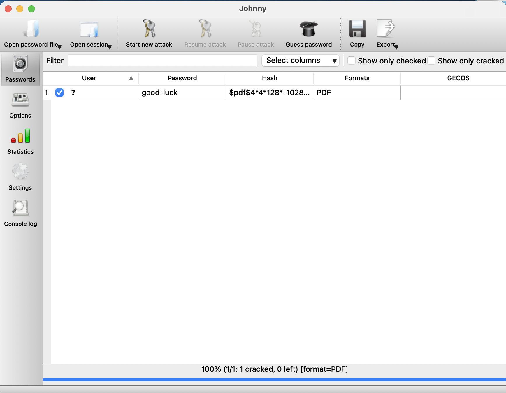
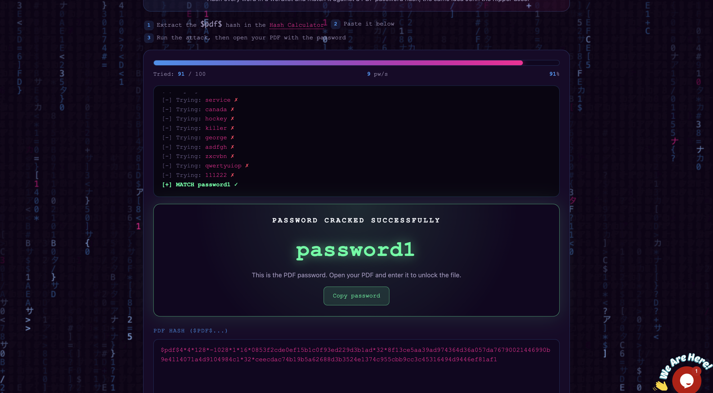
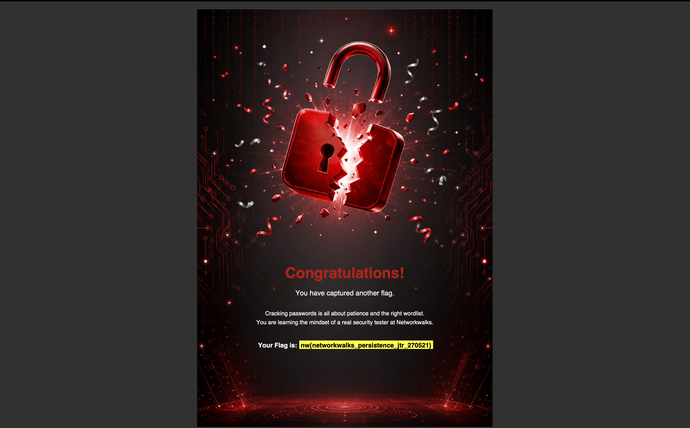
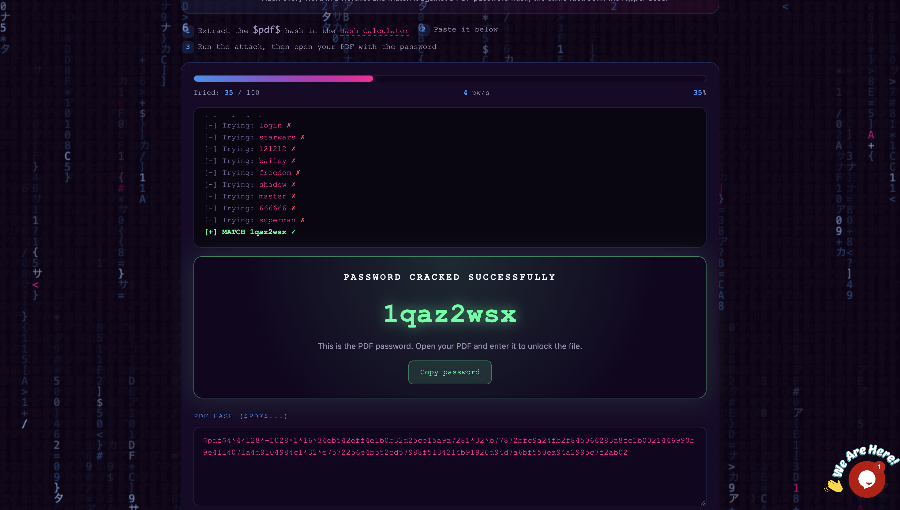

# Password Cracking & PDF Hash Recovery Assessment (Week 3)

Cryptographic hash extraction and offline dictionary-based password auditing using `pdf2john` and John the Ripper / Johnny.

---

## Engagement Metadata

| Field | Detail |
| :--- | :--- |
| **Pentester Name** | Siddhartha Gupta |
| **Program / Batch** | B084M - Networkwalks Cybersecurity Internship |
| **Phase Covered** | Phase 3: System Hacking & Password Cracking |
| **Target Assets** | 3 Password-Protected Lab PDF Files (`pdf1`, `pdf2`, `pdf3`) |
| **Tools Used** | `pdf2john`, John the Ripper (`john`) / Johnny GUI |
| **Permission Secured** | Yes (Authorized Lab Exercise) |

---

## Liability & Scope Disclaimer

All password auditing and hash recovery activities documented in this report were conducted strictly against authorized training lab files provided for educational assessment. No unauthorized third-party systems or files were targeted.

---

## Tools Used

| Tool | Purpose |
| :--- | :--- |
| **`pdf2john`** | Extracts cryptographic password hashes from encrypted PDF documents into a crackable format. |
| **`john` / Johnny** | Performs offline dictionary and brute-force password cracking against extracted hashes. |
| **Wordlists (`rockyou.txt`)** | Supplies candidate passwords for offline dictionary attacks. |

---

## Step 1: Hash Extraction & Offline Cracking

Extracted the encrypted hash strings from each target PDF file using `pdf2john` and recovered the plaintext passwords using John the Ripper / Johnny:

```bash
pdf2john pdf1.pdf > pdf1.hash
pdf2john pdf2.pdf > pdf2.hash
pdf2john pdf3.pdf > pdf3.hash

john --wordlist=/usr/share/wordlists/rockyou.txt pdf1.hash pdf2.hash pdf3.hash
john --show pdf1.hash pdf2.hash pdf3.hash
```

---

## Step 2: Verification & File Access Proof

### Target 1: `pdf1`
* **Locked Prompt:**
  
* **Unlocked Verification:**
  

### Target 2: `pdf2`
* **Locked Prompt:**
  
* **Unlocked Verification:**
  

### Target 3: `pdf3`
* **Locked Prompt:**
  
* **Unlocked Verification:**
  

---

## Security Impact & Remediation Recommendations

* **Attacker Impact:** Once an attacker obtains an encrypted document, password cracking occurs completely offline at high speed without triggering account lockouts or network alerts. Weak, short, or dictionary-based passwords are recovered within seconds.
* **Remediation:**
  1. Enforce strong, high-entropy passphrases (minimum 12–16 characters mixing uppercase, lowercase, numbers, and symbols) that do not appear in common wordlists.
  2. Use modern AES-256 PDF encryption standards rather than legacy RC4/weak revision handlers.
  3. Distribute sensitive documents via access-controlled portals with multi-factor authentication (MFA) instead of relying solely on static file passwords.
